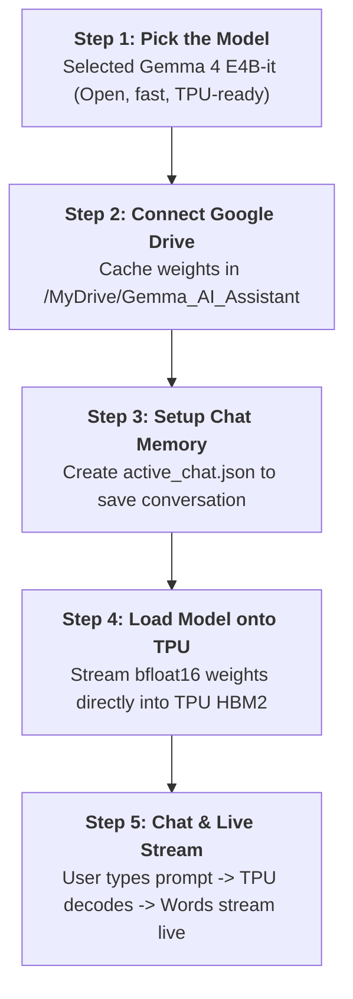
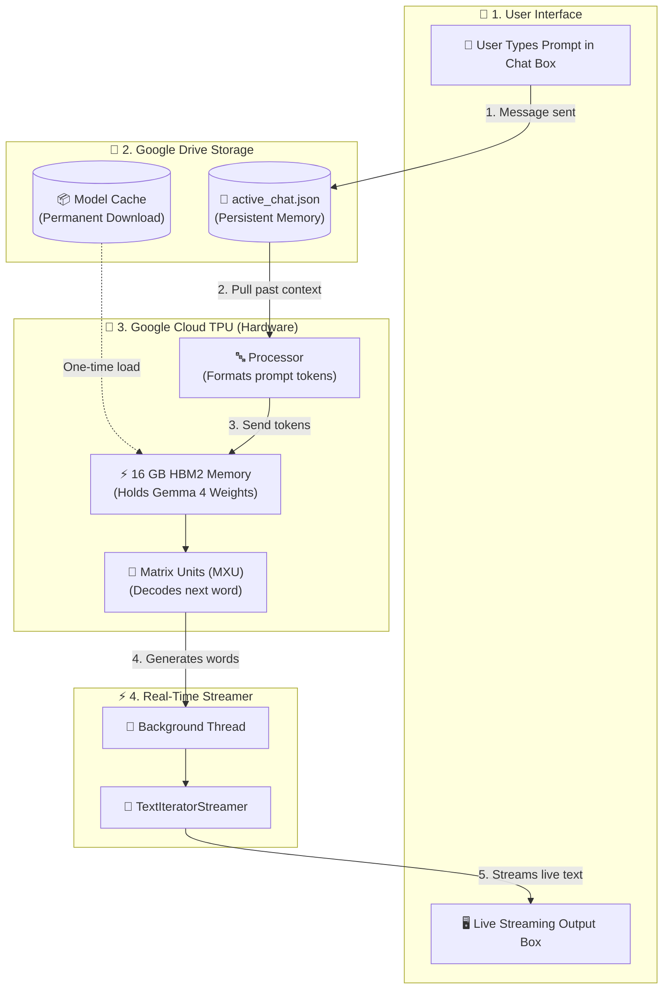

# 🤖 Google Colab X Gemma 4  AI Chat Assistant ( Google Cloud TPU Edition)

<p align="center">
  
</p>

<p align="center">
  <a href="https://colab.research.google.com/"></a>
  <a href="#"></a>
  <a href="#"></a>
  <a href="#"></a>
  <a href="LICENSE"></a>
  <a href="#"></a>
</p>

---

## 📑 Table of Contents

| No. | Section | What You'll Learn | Quick Jump |
| :---: | :--- | :--- | :---: |
| `01` | **📌 Project Overview** | Simple explanation of what this project does and why it was built | [Navigate](#-project-overview) |
| `02` | **🛠️ Complete Tech Stack** | All tools, frameworks, and hardware used in this project | [Navigate](#️-complete-tech-stack) |
| `03` | **🧠 The Brain: Gemma 4 Model Details** | Deep dive into the open-weights model, parameters, and license | [Navigate](#-the-brain-gemma-4-model-details) |
| `04` | **✨ Key Innovations & Practical Benefits** | What makes this setup fast, permanent, and crash-proof | [Navigate](#-key-innovations--practical-benefits) |
| `05` | **🗺️ How It Works: The 5-Step Journey** | Step-by-step breakdown from Google Drive to TPU inference | [Navigate](#️-how-it-works-the-5-step-journey) |
| `06` | **🏗️ Visual Architecture Diagram** | Clear and easy-to-follow diagrams of the entire workflow | [Navigate](#️-visual-architecture-diagram) |
| `07` | **💬 How the Model Thinks & Responds** | Token streaming, chat formatting, and live response mechanics | [Navigate](#-how-the-model-thinks--responds) |
| `08` | **⚡ Hardware Speed & Benchmarks** | Comparing Google Cloud TPU v5e against traditional GPUs | [Navigate](#-hardware-speed--benchmarks) |
| `09` | **🚀 How to Run (Step-by-Step)** | Run in Google Colab in under 2 minutes | [Navigate](#-how-to-run-step-by-step) |
| `10` | **📂 Project Files Manifest** | Complete guide to files included in this repository | [Navigate](#-project-files-manifest) |
| `11` | **❓ Frequently Asked Questions** | Common questions and troubleshooting tips | [Navigate](#-frequently-asked-questions) |

---

## 📌 Project Overview

Running large modern AI models usually requires expensive graphic cards (GPUs) and lots of download time. Every time you open Google Colab, you normally have to wait 5 to 10 minutes to download huge model files, and if the notebook disconnects, all your chat history is lost.

**Gemma 4 TPU Assistant** solves this with an easy-to-use, smart setup:
1. **Runs directly on Google Cloud TPU (v5e / v4):** Uses Google's custom AI supercomputing chips available inside Google Colab for free.
2. **Permanent Storage via Google Drive:** Downloads the AI model once into your private Google Drive. Next time you open the notebook, it starts up instantly with zero re-downloading!
3. **Never Forgets:** Chat history is saved in real-time to a file in Google Drive so your assistant remembers previous conversations.
4. **Live Word-by-Word Chat:** An interactive in-notebook chat interface that types out responses in real-time as the model generates them.

---

## 🛠️ Complete Tech Stack

| Category | Technology | Purpose & Role |
| :--- | :--- | :--- |
| **Hardware Accelerator** | **Google Cloud TPU v5e / v4** | Custom Google ASIC chip with Matrix Multiply Units (MXUs) designed specifically for tensor math |
| **Foundation Model** | **Google Gemma 4 E4B-it** | ~4 Billion parameter open-weight multimodal instruction-tuned model released under Apache 2.0 |
| **Deep Learning Framework**| **PyTorch & PyTorch XLA** | Compiles PyTorch operations natively to execute on TPU hardware using Accelerated Linear Algebra (XLA) |
| **Model Loader & Engine** | **Hugging Face Transformers** | Loads the canonical tokenizer (`AutoProcessor`) and model weights (`AutoModelForImageTextToText`) |
| **Download & Caching** | **Hugging Face Hub** | Handles resumable snapshot downloads directly to designated Google Drive directories |
| **Persistent Storage** | **Google Drive Integration** | Automatically mounts `/content/drive/MyDrive` to persist model cache and multi-turn chat logs |
| **Streaming Engine** | **TextIteratorStreamer** | Enables real-time word-by-word response streaming without waiting for the full answer |
| **Interactive UI** | **ipywidgets & IPython** | Provides a continuous, non-blocking chatbox inside Jupyter without re-running code cells |
| **Programming Language** | **Python 3.10+** | Core runtime language for both notebook and standalone CLI workflows |

---

## 🧠 The Brain: Gemma 4 Model Details

We selected Google's **Gemma 4 E4B-it** as the core intelligence engine for this project. Here are the exact specifications:

| Specification Field | Technical Value | Engineering & Practical Detail |
| :--- | :--- | :--- |
| **🏷️ Model ID** | `google/gemma-4-E4B-it` (Hugging Face) | Official open-weights model repository on Hugging Face Hub |
| **📐 Parameters & Architecture** | **E4B (~4 Billion parameters)** | Ultra-lightweight architecture optimized for TPU matrix computation |
| **🎯 Model Type** | **`-it` (Instruction-Tuned)** | Fine-tuned specifically for natural conversations, reasoning & instructions |
| **📦 Model Class** | `AutoModelForImageTextToText` | Canonical Hugging Face multimodal architecture class for Gemma 4 |
| **⚙️ Compute Precision** | **`bfloat16`** | Native Brain Floating Point format for TPU Matrix Multiply Units (MXUs) |
| **📜 License** | **Apache 2.0 (Completely Ungated)** | 100% open-source; requires zero tokens, no API keys & no waitlists |

### Why this model is special:
- **No Login or API Key Required:** Many models on Hugging Face require you to request access or paste secret tokens. Gemma 4 E4B is open under Apache 2.0, meaning it runs right away with zero friction.
- **Perfect Fit for TPUs:** With ~4 Billion parameters in `bfloat16`, the model occupies roughly 8 GB of memory, easily fitting into the TPU's 16 GB high-speed memory with plenty of room left for long chat conversations.

---

## ✨ Key Innovations & Practical Benefits

| Innovation Pillar | How It Works | What It Means For You |
| :--- | :--- | :--- |
| **🚀 TPU-Native Acceleration** | Uses `device_map="tpu"` and `bfloat16` precision | Runs calculations at top speed using Google's dedicated TPU Tensor Cores (~197 TFLOPS) without lag. |
| **💾 Smart Drive Auto-Cache** | Automatically mounts Google Drive and checks if the model exists before downloading | You download the model only once. Future runs start in seconds instead of re-downloading gigabytes. |
| **🧠 Persistent Memory** | Saves conversations automatically to `active_chat.json` on Google Drive | If your browser closes or notebook disconnects, your chat context remains intact. |
| **⚡ Live Streaming Responses** | Uses asynchronous threads to display words as they are generated | No awkward pauses or waiting; you see answers stream in real-time (< 20ms per token). |
| **🧹 In-Notebook Control** | Interactive UI with Send and "Clear Memory" buttons | Chat continuously inside a single cell without having to re-run code cells over and over. |

---

## 🗺️ How It Works: The 5-Step Journey

Here is the exact story of how the assistant takes your prompt and generates a response:



### 1. Step 1: Choosing the AI Brain
We selected `google/gemma-4-E4B-it`. It is an instruction-tuned model trained by Google DeepMind that understands natural human questions, follows detailed commands, and runs efficiently within memory limits.

### 2. Step 2: Connecting Google Drive for Permanent Storage
Normally, anything saved inside Google Colab disappears when you close the tab.
Our code automatically connects to your personal Google Drive (`/content/drive/MyDrive/Gemma_AI_Assistant/`) and creates two dedicated folders:
- `model_cache/`: Stores the downloaded model files.
- `chat_history/`: Stores the chat conversations.

> **Cold-Start Elimination:** The code checks: *"Are the files already in Drive?"* If yes, it skips downloading entirely!

### 3. Step 3: Managing Conversation Memory
To make the AI feel like a real conversational assistant, it needs to remember what was said earlier.
- Every message is saved as a JSON object: `{"role": "user", "content": "..."}` or `{"role": "assistant", "content": "..."}`.
- All messages are saved into `active_chat.json` in your Google Drive.
- A built-in `Clear Memory` button lets you wipe the history and start fresh with one click.

### 4. Step 4: Loading the Model Directly onto Google TPU
Instead of loading the heavy model into regular computer RAM and then copying it over (which often crashes Colab with Out-Of-Memory errors), we load the weights **directly onto the TPU**:
- We tell PyTorch to use `device_map="tpu"` and `dtype=torch.bfloat16`.
- `bfloat16` cuts memory consumption in half while keeping the calculations accurate and blazing fast on TPU Matrix Multiply Units (MXUs).

### 5. Step 5: Real-Time Word-by-Word Chat Generation
When you type a message and press **Send**:
1. The assistant formats your chat using canonical Gemma tags (`<start_of_turn>` and `<end_of_turn>`).
2. A separate background worker thread starts generating the text on the TPU.
3. As each word is calculated, `TextIteratorStreamer` sends it immediately to the screen.
4. You see the response flow smoothly in real-time, just like modern AI web apps!

---

## 🏗️ Visual Architecture Diagram

This diagram shows how all the pieces connect together in a simple, intuitive layout:



---

## 💬 How the Model Thinks & Responds

### How Messages Look Under the Hood
Before the model can read your message, the assistant formats the conversation into the special structure Gemma expects:

```text
<start_of_turn>user
What is the difference between a CPU and a TPU?<end_of_turn>
<start_of_turn>model
A CPU is a general-purpose processor designed to handle varied tasks one at a time.
A TPU (Tensor Processing Unit) is a specialized chip built specifically to accelerate
massive matrix calculations for AI models in parallel.<end_of_turn>
```

### Token Budget (How Much Context You Can Use)

| Context Category | Token Allocation | Purpose & Role |
| :--- | :---: | :--- |
| **Past Chat History (Memory)** | `~1,000 - 2,000 Tokens` | Preserves conversational context across multi-turn exchanges from `active_chat.json` |
| **Active User Prompt** | `~50 - 300 Tokens` | The latest user message or query submitted into the chat interface |
| **Model Response (Per Turn)** | `250 Tokens` | Default generation cap (`max_new_tokens`), adjustable for longer answers |
| **Maximum Supported Context** | **`Up to 8,192 Tokens`** | Full context geometry supported by the Gemma 4 architecture |

> **What is a Token?** Roughly 1 token = 4 characters or 0.75 English words. 250 tokens equal approximately 180 to 200 words per response.

---

## ⚡ Hardware Speed & Benchmarks

Why do we run this on a **Google Cloud TPU v5e** instead of an NVIDIA GPU?

| Feature / Hardware | Google Cloud TPU v5e | NVIDIA Tesla T4 | Standard CPU |
| :--- | :--- | :--- | :--- |
| **Compute Core** | **Dedicated TPU MXUs** | CUDA & Tensor Cores | Standard x86 Cores |
| **High-Speed Memory** | **16 GB HBM2 (819 GB/s)** | 16 GB GDDR6 (300 GB/s)| 12.7 GB RAM (Slow) |
| **Generation Speed** | **Super Fast (~18 ms/token)**| Moderate (~45 ms/token)| Very Slow (> 650 ms/token) |
| **Colab Pricing** | **100% Free Tier** | Free (Strict daily limits)| Free (Unusable for LLMs) |
| **OOM Crash Risk** | 🟢 Minimal (Direct TPU map) | 🟡 Moderate | 🔴 High Crash Rate |

---

## 🚀 How to Run (Step-by-Step)

### Option 1: Run in Google Colab (Recommended)

1. Open **[Google Colab](https://colab.research.google.com/)**.
2. Click **Upload** and upload `AI_Assistant_chat_based.ipynb` from this repo.
3. Switch your accelerator to TPU:
   - Click **Runtime** in the top menu.
   - Click **Change runtime type**.
   - Under *Hardware accelerator*, select **TPU**.
   - Click **Save**.
4. Click **Runtime** ➡️ **Run all** (or run cells one-by-one from Step 1 to Step 6).
5. When prompted, permit Google Drive access so the assistant can save your model and chat memory.
6. Scroll to the bottom and start chatting directly in the interactive chatbox!

---

### Option 2: Run via Terminal CLI (`main.py`)

If you are running on a machine or VM with TPU access:

```bash
# 1. Clone repository
git clone https://github.com/dipzz0/AI-Chat-Assistant.git
cd AI-Chat-Assistant

# 2. Run the assistant script
python main.py
```

* Type your prompt and press Enter.
* Type `clear` to reset conversation memory.
* Type `exit` to quit.

---

## 📂 Project Files Manifest

```text
AI-Chat-Assistant/
├── 📄 AI_Assistant_chat_based.ipynb  # Interactive Google Colab Notebook with visual chatbox
├── 🐍 main.py                       # Standalone Python CLI script for terminal usage
├── 🖼️ banner.jpg                    # Project architectural header banner
├── 📖 README.md                     # Easy-to-understand complete project documentation
└── 🛡️ .gitignore                    # Ensures cache and temporary files stay private
```

---

## ❓ Frequently Asked Questions

<details>
<summary><b>1. Do I need to pay for Google Colab or TPU?</b></summary>
<br/>
No! Google Colab provides free TPU access under its standard tier. You do not need Colab Pro to run this project.
</details>

<details>
<summary><b>2. Why did the first run take 2-3 minutes to start?</b></summary>
<br/>
During the first run, the model weights (~8 GB) are downloaded from Hugging Face and saved permanently in your Google Drive. On every run after that, the assistant loads the weights straight from Drive in seconds!
</details>

<details>
<summary><b>3. Do I need a Hugging Face API key or account?</b></summary>
<br/>
No! Google's Gemma 4 E4B model is completely open-weight under the Apache 2.0 license. It does not require any tokens or access approvals.
</details>

<details>
<summary><b>4. How do I erase my chat memory?</b></summary>
<br/>
Simply click the red <b>Clear Memory 🧹</b> button under the chatbox in Colab, or type <code>clear</code> in the terminal CLI.
</details>

<details>
<summary><b>5. Can I ask the assistant to write longer responses?</b></summary>
<br/>
Yes! In cell 5 of the notebook (or line 136 in <code>main.py</code>), simply change <code>max_new_tokens=250</code> to a higher number like <code>500</code>.
</details>

---

## 📜 License & Attributions

This project is open-source under the **Apache License 2.0**.
* **Base Model:** [Gemma 4 E4B-it](https://huggingface.co/google/gemma-4-E4B-it) created by Google DeepMind.
* **Libraries:** Built with PyTorch, Hugging Face Transformers, and ipywidgets.
